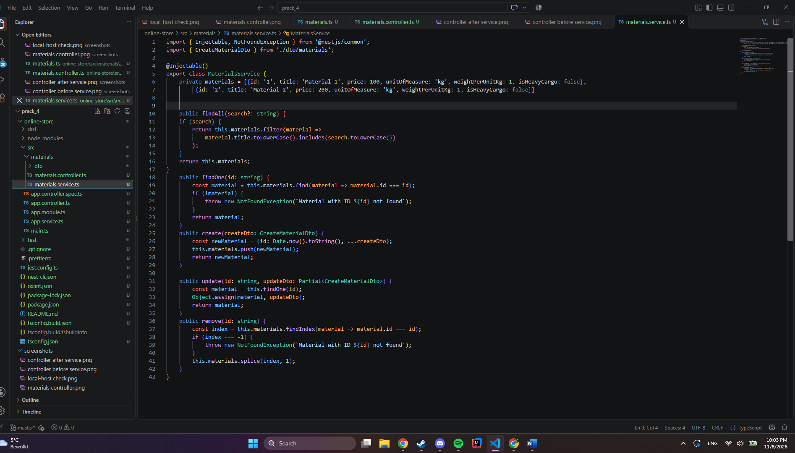

# Практична робота №4. Розроблення REST-ендпоінтів засобами NestJS

**Виконав:** Григоряк Роман, група КН-42
**Варіант:** 6 (Будівельні матеріали, префікс `/materials`)

## Опис

REST API для керування каталогом будівельних матеріалів на NestJS. Реалізовано контролер, сервіс з in-memory сховищем, DTO-класи, обробку виключень, query-фільтрацію та кастомні заголовки відповіді.

## Структура проєкту

```
src/
├── materials/
│   ├── dto/
│   │   ├── create-material.dto.ts
│   │   └── update-material.dto.ts
│   ├── materials.controller.ts
│   └── materials.service.ts
├── app.module.ts
└── main.ts
requests.http
```

## Запуск

```
npm install
npm run start:dev
```

Сервер стартує на `http://localhost:3000`.


## Рівень 1. Проєкт, контролер, DTO

- Проєкт створено через `npx @nestjs/cli new online-store --strict --package-manager npm`.
- Контролер згенеровано командою `npx @nestjs/cli g co materials --no-spec`, він автоматично зареєстрований у `AppModule`.
- `CreateMaterialDto` містить поля `title`, `price`, `unitOfMeasure`, `weightPerUnitKg`, `isHeavyCargo`. У `UpdateMaterialDto` усі поля необов'язкові.
- Реалізовано `@Get()`, `@Get(':id')`, `@Post()`.


## Рівень 2. Сервіс, CRUD і HTTP-статуси

- Сервіс (`@Injectable()`) містить приватне in-memory сховище з початковими записами та методи `findAll`, `findOne`, `create`, `update`, `remove`.
- Якщо запис не знайдено, кидається `NotFoundException` (відповідь 404).
- Сервіс впроваджено в контролер через конструктор (Dependency Injection), контролер лише делегує виклики.
- `@Post()` повертає `201 Created`, `@Delete(':id')` повертає `204 No Content` (через `@HttpCode`).




### Результати перевірки

| Запит | Очікуваний статус | Скриншот |
|---|---|---|
| `GET /materials` | 200 OK |  |
| `GET /materials/:id` (існуючий) | 200 OK |  |
| `GET /materials/99999` | 404 Not Found |  |
| `POST /materials` | 201 Created |  |
| `PATCH /materials/:id` | 200 OK |  |
| `DELETE /materials/:id` | 204 No Content |  |


## Рівень 3. Query-фільтрація, заголовки, тестування

- `GET /materials?search=...` шукає за підрядком у `title` без урахування регістру (`toLowerCase()`).
- `GET /materials?limit=...` обмежує кількість записів у видачі.
- Через `@Header()` до відповіді додано заголовки `X-API-Version: 1.0` та `X-Service-Status: operational`.
- Усі запити для перевірки зібрано у файлі `requests.http` (розширення REST Client).


## Відповіді на контрольні питання

**1. Що таке IoC та як реалізований DI у NestJS?**
Інверсія керування означає, що створенням і життєвим циклом об'єктів керує фреймворк, а не сам код. У NestJS клас позначається `@Injectable()`, а залежності оголошуються в конструкторі (`constructor(private readonly service: MaterialsService)`). IoC-контейнер сам створює екземпляр сервісу й передає його в контролер.

**2. Різниця між `@Module`, `@Controller`, `@Injectable`.**
Модуль групує пов'язані частини застосунку. Контролер приймає HTTP-запити й повертає відповіді. Провайдер (сервіс) містить бізнес-логіку й роботу з даними, його можна впроваджувати через DI.

**3. Чому DTO це класи, а не інтерфейси?**
Інтерфейси зникають після компіляції (type erasure), а класи залишаються в JavaScript. Тому NestJS може використовувати їх під час виконання, наприклад для валідації та метаданих.

**4. Декоратори для даних запиту.**
`@Param('id')` бере параметр шляху (`/materials/5`), `@Query('search')` бере query-параметр (`?search=cem`), `@Body()` бере тіло запиту (DTO), `@Headers('x-key')` бере заголовок.

**5. Статуси за замовчуванням і `@HttpCode()`.**
GET повертає 200, POST повертає 201, DELETE за замовчуванням повертає 200. Щоб змінити, додають `@HttpCode(HttpStatus.NO_CONTENT)` над методом (так зроблено для DELETE).

**6. Обробка виключень у NestJS.**
Є вбудований exception filter, який перехоплює виключення й формує відповідь. `throw new NotFoundException()` повертає статус 404 і JSON `{ "message": "...", "error": "Not Found", "statusCode": 404 }`.

**7. Як додати заголовок через `@Header()`?**
Декоратор ставиться над методом: `@Header('X-API-Version', '1.0')`. Перший аргумент це назва заголовка, другий значення, яке потрапить у відповідь.

**8. PUT і PATCH.**
PUT замінює ресурс цілком (треба надіслати всі поля), PATCH змінює лише передані поля. У роботі для часткового оновлення використано PATCH з `UpdateMaterialDto`.